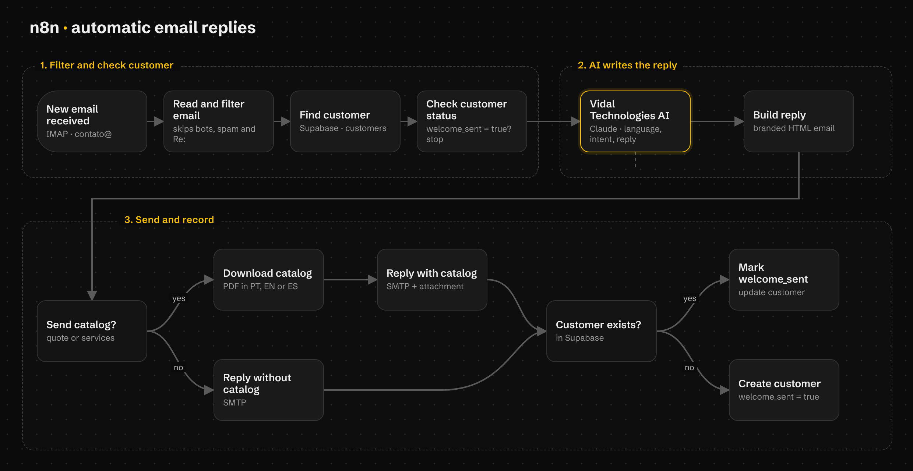
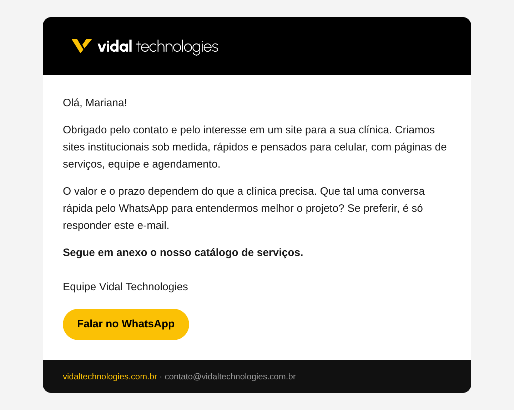
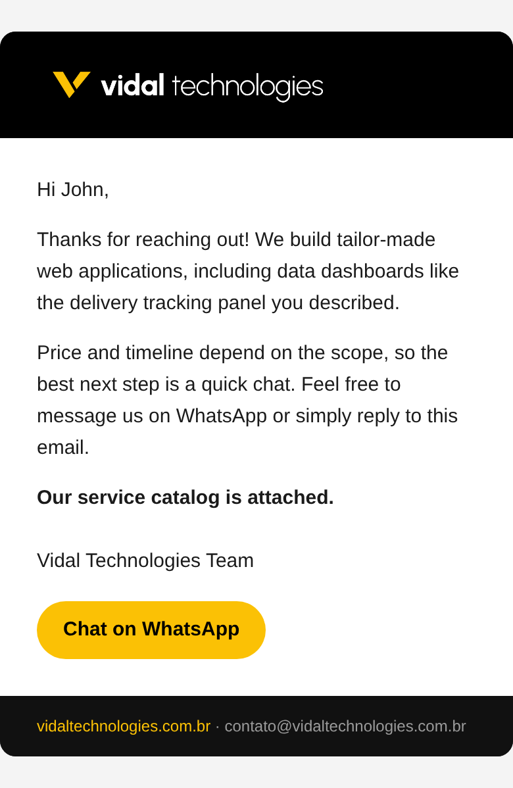

<p align="center">
  
</p>

<h1 align="center">AI email auto-reply</h1>

<p align="center">
  An <strong>n8n</strong> workflow that reads the contact emails of <strong>Vidal Technologies</strong>, replies with AI in the sender's language and sends the service catalog.<br />
  Replies in Portuguese, English and Spanish.
</p>

<p align="center">
  <a href="README.md">Português</a> · <strong>English</strong> · <a href="README.es.md">Español</a>
</p>

<p align="center">
  
  
  
  
  
</p>



## About the project

When someone writes to **contato@vidaltechnologies.com.br**, this workflow reads the
message, understands what the person wants and replies within seconds, in the same
language as the email. If the person asks for a quote or wants to know the services,
the PDF catalog is attached in the right language.

The automation only answers the **first contact**. Replies inside a conversation and
people who already got the welcome email are left for a human, so nobody gets the
catalog twice or talks to a bot without knowing it.

The project is also a portfolio piece: it shows, in practice, the kind of AI
automation Vidal Technologies builds for its clients.

### Goals

- Answer people who get in touch quickly, at any time.
- Serve clients in Brazil and abroad, in Portuguese, English and Spanish.
- Send the catalog only to people who showed interest.
- Leave follow-up conversations to a person on the team.

## How it works

1. **New email:** n8n checks the inbox over IMAP.
2. **Filter:** skips bots, newsletters, auto-replies, emails sent by us and any reply
   inside a conversation (`Re:`, `RES:`, `Fwd:`...).
3. **Customer in Supabase:** looks up the email in the `customers` table. If the
   person already got the welcome email (`welcome_sent = true`), the workflow stops.
4. **AI (Claude):** reads the message and returns JSON with the language, the category
   (quote, question, partnership, support, spam), whether to reply, whether to send
   the catalog and the reply text. The AI never makes up prices or timelines.
5. **Branded email:** builds the HTML reply with the logo, a WhatsApp button and a
   footer, also prepared for Gmail's dark mode on phones.
6. **Send:** when needed, downloads the PDF catalog in the right language and attaches
   it. Sends over SMTP.
7. **Record:** sets `welcome_sent = true` on the customer, or creates the customer if
   they did not exist yet.

## Screens

| Email on desktop (Portuguese) | Email on a phone (English) |
| --- | --- |
|  |  |

## Technologies

| Technology | What it is used for |
| --- | --- |
| [n8n](https://n8n.io/) | Runs the workflow: reads the email, calls the AI, sends the reply |
| [Claude](https://www.anthropic.com/claude) (Anthropic) | Understands the message, detects the language and writes the reply |
| [Supabase](https://supabase.com/) | `customers` table that stores who already got the welcome email |
| JavaScript (n8n Code nodes) | Email filtering and building the HTML email |
| IMAP and SMTP (Hostinger) | Reading and sending the domain's emails |

## How to use it

You will need an n8n account, an Anthropic API key, a Supabase project and an email
account with IMAP and SMTP.

1. **Database:** in Supabase, open **SQL Editor** and run
   [`supabase/customers.sql`](supabase/customers.sql). For test data, then run
   [`supabase/sample-data.sql`](supabase/sample-data.sql).
2. **Import the workflow:** in n8n, create a workflow, click the three dots and choose
   **Import from File**. Pick [`workflow/email-auto-reply.json`](workflow/email-auto-reply.json).
3. **Credentials:** create and select the IMAP, SMTP, Supabase and Anthropic
   credentials in the nodes. In the Supabase nodes, replace
   `YOUR_SUPABASE_PROJECT_REF` with your project's ref.
4. **Customize:** in the **Read and filter email** node, change the contact email. In
   the **Build reply** node, change the website, the catalog links and the signature.
   The instructions for the AI are in the **Vidal Technologies AI** node.
5. **Test and publish:** send a test email and, once everything looks right, click
   **Publish** so the workflow runs on its own.

The exported file has no passwords or keys. Everyone uses their own credentials inside
n8n.

## Structure

```
workflow/
└── email-auto-reply.json   # Workflow to import into n8n
supabase/
├── customers.sql           # customers table, indexes and updated_at trigger
└── sample-data.sql         # Fictional customers for testing
docs/                       # Images used in this README
```

---

© Vidal Technologies. All rights reserved.
