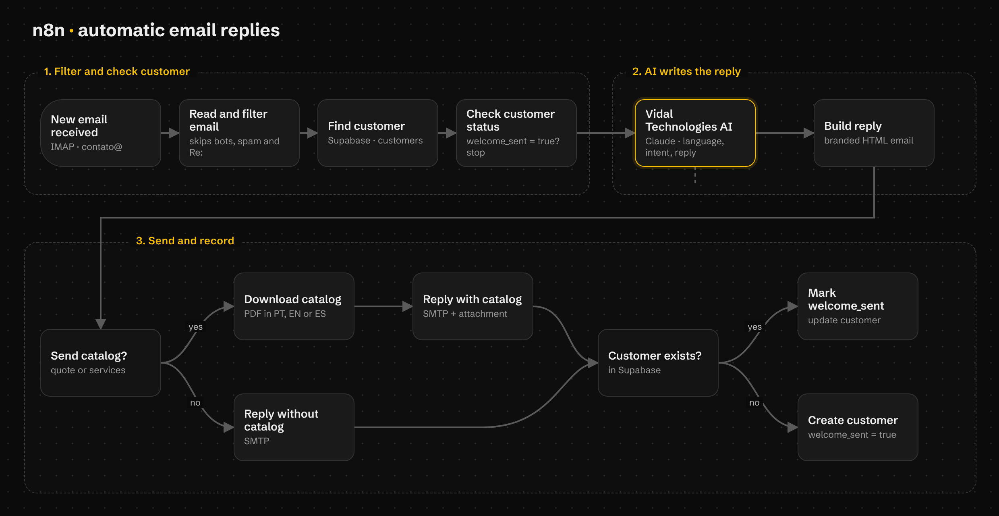
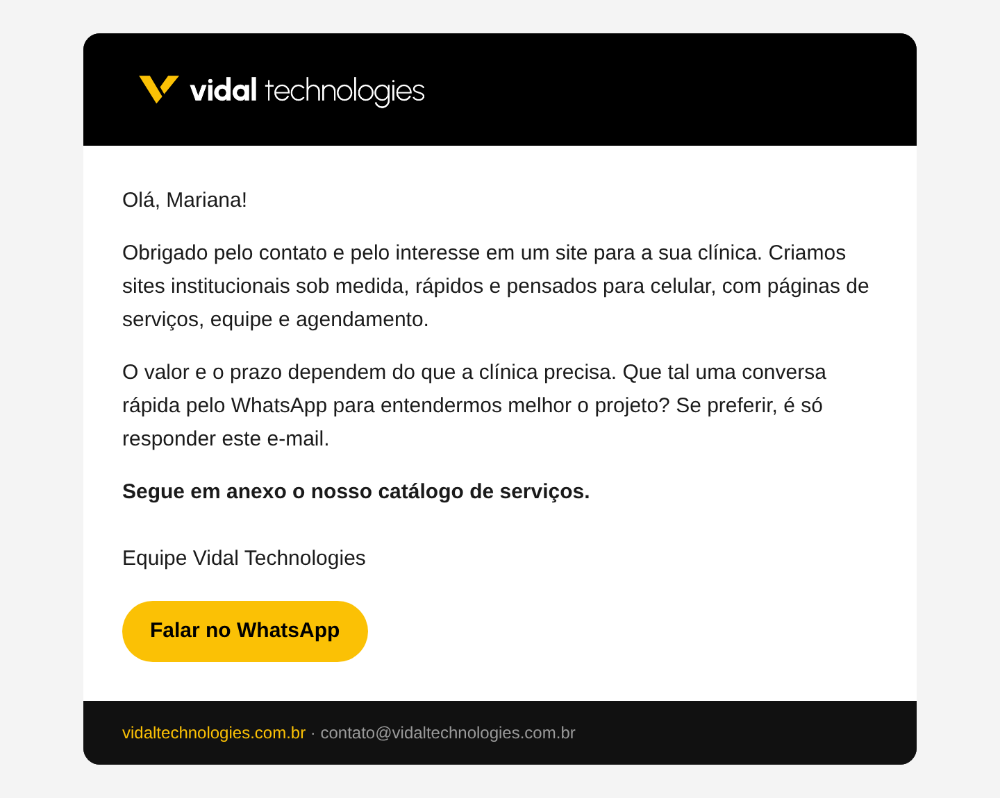
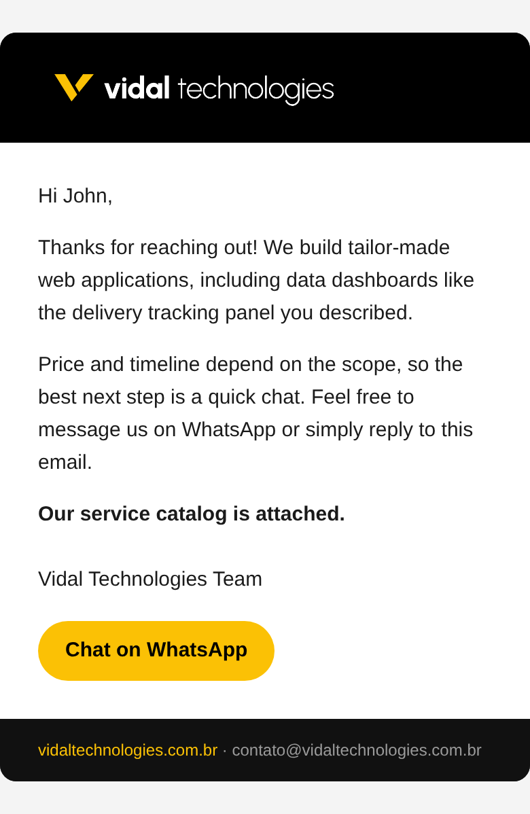

<p align="center">
  
</p>

<h1 align="center">Respuesta automática de correos con IA</h1>

<p align="center">
  Flujo de <strong>n8n</strong> que lee los correos de contacto de <strong>Vidal Technologies</strong>, responde con IA en el idioma de quien escribió y envía el catálogo de servicios.<br />
  Responde en portugués, inglés y español.
</p>

<p align="center">
  <a href="README.md">Português</a> · <a href="README.en.md">English</a> · <strong>Español</strong>
</p>

<p align="center">
  
  
  
  
  
</p>



## Sobre el proyecto

Cuando alguien escribe a **contato@vidaltechnologies.com.br**, este flujo lee el
mensaje, entiende lo que la persona quiere y responde en pocos segundos, en el mismo
idioma del correo. Si la persona pide un presupuesto o quiere conocer los servicios,
el catálogo en PDF va adjunto en el idioma correcto.

La automatización responde solo el **primer contacto**. Las respuestas dentro de una
conversación y las personas que ya recibieron la bienvenida quedan para un humano,
para que nadie reciba el catálogo dos veces ni hable con un robot sin saberlo.

El proyecto también es una pieza de portafolio: muestra, en la práctica, el tipo de
automatización con IA que Vidal Technologies entrega a sus clientes.

### Objetivos

- Responder rápido a quien se pone en contacto, a cualquier hora.
- Atender a clientes en Brasil y en el exterior, en portugués, inglés y español.
- Enviar el catálogo solo a quien mostró interés.
- Dejar las conversaciones siguientes a una persona del equipo.

## Cómo funciona

1. **Nuevo correo:** n8n revisa la bandeja de entrada por IMAP.
2. **Filtro:** ignora robots, newsletters, respuestas automáticas, correos enviados por
   nosotros y cualquier respuesta dentro de una conversación (`Re:`, `RES:`, `Fwd:`...).
3. **Cliente en Supabase:** busca el correo en la tabla `customers`. Si la persona ya
   recibió la bienvenida (`welcome_sent = true`), el flujo se detiene.
4. **IA (Claude):** lee el mensaje y devuelve un JSON con el idioma, la categoría
   (presupuesto, duda, alianza, soporte, spam), si debe responder, si debe enviar el
   catálogo y el texto de la respuesta. La IA nunca inventa precios ni plazos.
   Los correos en otros idiomas (francés, alemán...) no reciben respuesta automática
   y quedan para un humano.
5. **Correo con la marca:** arma la respuesta en HTML con logo, botón de WhatsApp y
   pie de página, preparada también para el modo oscuro de Gmail en el celular.
6. **Envío:** si corresponde, descarga el catálogo en PDF en el idioma correcto y lo
   adjunta. Envía por SMTP.
7. **Registro:** marca `welcome_sent = true` en el cliente, o crea el cliente si
   todavía no existía.

## Pantallas

| Correo en la computadora (portugués) | Correo en el celular (inglés) |
| --- | --- |
|  |  |

## Tecnologías

| Tecnología | Para qué sirve |
| --- | --- |
| [n8n](https://n8n.io/) | Orquesta el flujo: lee el correo, llama a la IA, envía la respuesta |
| [Claude](https://www.anthropic.com/claude) (Anthropic) | Entiende el mensaje, detecta el idioma y escribe la respuesta |
| [Supabase](https://supabase.com/) | Tabla `customers`, que guarda quién ya recibió la bienvenida |
| JavaScript (nodos Code de n8n) | Filtro de los correos y armado del correo en HTML |
| IMAP y SMTP (Hostinger) | Lectura y envío de los correos del dominio |

## Cómo usarlo

Vas a necesitar una cuenta de n8n, una clave de la API de Anthropic, un proyecto de
Supabase y una cuenta de correo con IMAP y SMTP.

1. **Base de datos:** en Supabase, abre **SQL Editor** y ejecuta
   [`supabase/customers.sql`](supabase/customers.sql). Si quieres datos de prueba,
   ejecuta después [`supabase/sample-data.sql`](supabase/sample-data.sql).
2. **Importar el flujo:** en n8n, crea un workflow, haz clic en los tres puntos y elige
   **Import from File**. Selecciona [`workflow/email-auto-reply.json`](workflow/email-auto-reply.json).
3. **Credenciales:** crea y elige en los nodos las credenciales de IMAP, SMTP, Supabase
   y Anthropic. En los nodos de Supabase, cambia `YOUR_SUPABASE_PROJECT_REF` por el
   código de tu proyecto.
4. **Personalizar:** en el nodo **Read and filter email**, cambia el correo de
   contacto. En el nodo **Build reply**, cambia el sitio, los enlaces de los catálogos
   y la firma. Las instrucciones para la IA están en el nodo **Vidal Technologies AI**.
5. **Probar y publicar:** envía un correo de prueba y, cuando todo esté bien, haz clic
   en **Publish** para que el flujo funcione solo.

El archivo exportado no tiene contraseñas ni claves. Cada persona usa sus propias
credenciales dentro de n8n.

## Estructura

```
workflow/
└── email-auto-reply.json   # Flujo para importar en n8n
supabase/
├── customers.sql           # Tabla customers, índices y trigger de updated_at
└── sample-data.sql         # Clientes ficticios para pruebas
docs/                       # Imágenes usadas en este README
```

---

© Vidal Technologies. Todos los derechos reservados.
