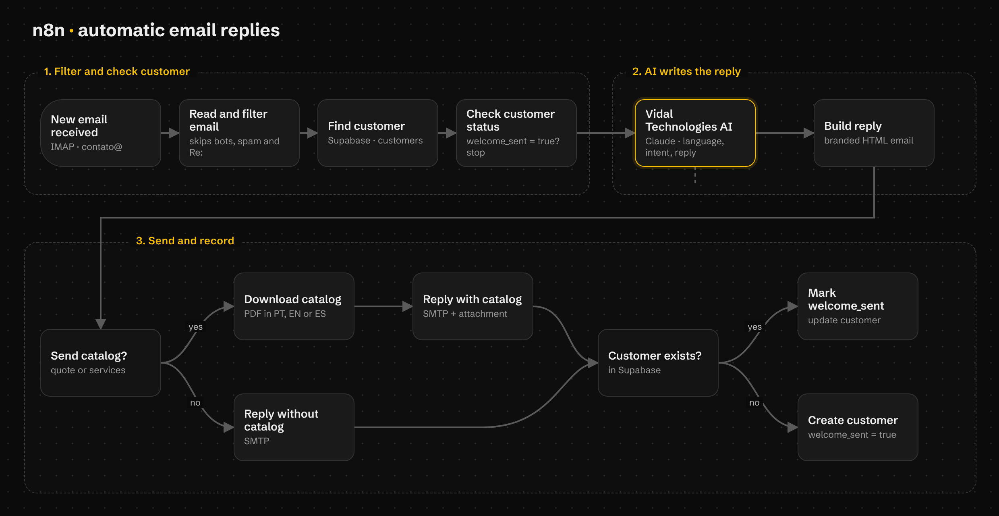
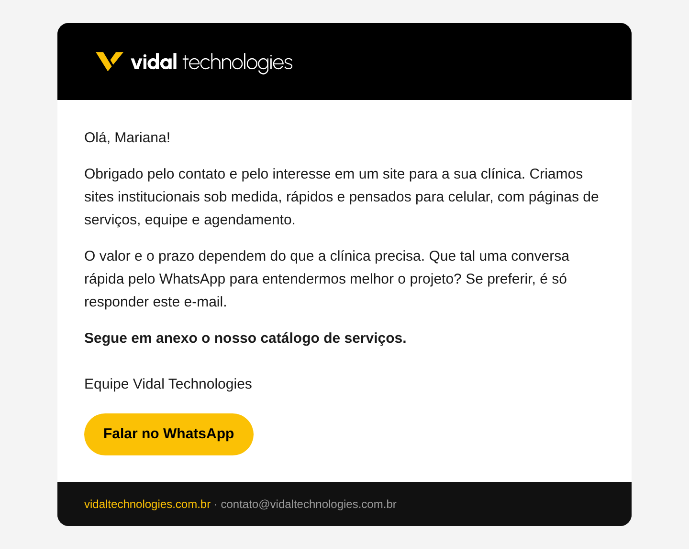
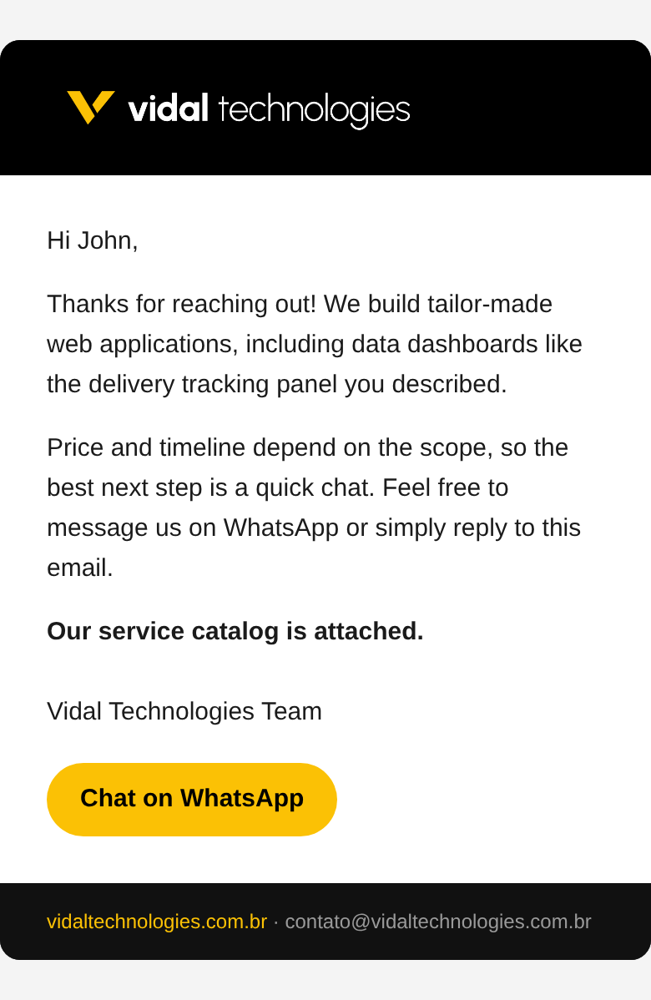

<p align="center">
  
</p>

<h1 align="center">Resposta automática de e-mails com IA</h1>

<p align="center">
  Fluxo do <strong>n8n</strong> que lê os e-mails de contato da <strong>Vidal Technologies</strong>, responde com IA no idioma de quem escreveu e envia o catálogo de serviços.<br />
  Responde em português, inglês e espanhol.
</p>

<p align="center">
  <strong>Português</strong> · <a href="README.en.md">English</a> · <a href="README.es.md">Español</a>
</p>

<p align="center">
  
  
  
  
  
</p>



## Sobre o projeto

Quando alguém escreve para **contato@vidaltechnologies.com.br**, este fluxo lê a
mensagem, entende o que a pessoa quer e responde em poucos segundos, no mesmo
idioma do e-mail. Se a pessoa pedir orçamento ou quiser conhecer os serviços, o
catálogo em PDF vai anexado no idioma certo.

A automação responde só o **primeiro contato**. Respostas dentro de uma conversa e
pessoas que já receberam as boas-vindas ficam para um humano, para que ninguém
receba o catálogo duas vezes nem converse com um robô sem saber.

O projeto também funciona como peça de portfólio: mostra, na prática, o tipo de
automação com IA que a Vidal Technologies entrega para os clientes.

### Objetivos

- Responder rápido quem entra em contato, a qualquer hora.
- Atender clientes no Brasil e no exterior, em português, inglês e espanhol.
- Enviar o catálogo só para quem demonstrou interesse.
- Deixar as conversas seguintes com uma pessoa da equipe.

## Como funciona

1. **Novo e-mail:** o n8n confere a caixa de entrada por IMAP.
2. **Filtro:** ignora robôs, newsletters, respostas automáticas, e-mails enviados por
   nós mesmos e qualquer resposta dentro de uma conversa (`Re:`, `RES:`, `Fwd:`...).
3. **Cliente no Supabase:** procura o e-mail na tabela `customers`. Se a pessoa já
   recebeu as boas-vindas (`welcome_sent = true`), o fluxo para.
4. **IA (Claude):** lê a mensagem e devolve um JSON com o idioma, a categoria
   (orçamento, dúvida, parceria, suporte, spam), se deve responder, se deve enviar
   o catálogo e o texto da resposta. A IA nunca inventa preços nem prazos.
   E-mails em outros idiomas (francês, alemão...) não recebem resposta automática
   e ficam para um humano.
5. **E-mail com a marca:** monta a resposta em HTML com logo, botão do WhatsApp e
   rodapé, preparada também para o modo escuro do Gmail no celular.
6. **Envio:** se for o caso, baixa o catálogo em PDF no idioma certo e anexa. Envia
   por SMTP.
7. **Registro:** marca `welcome_sent = true` no cliente, ou cria o cliente se ele
   ainda não existia.

## Telas

| E-mail no computador (português) | E-mail no celular (inglês) |
| --- | --- |
|  |  |

## Tecnologias

| Tecnologia | Para que serve |
| --- | --- |
| [n8n](https://n8n.io/) | Orquestra o fluxo: lê o e-mail, chama a IA, envia a resposta |
| [Claude](https://www.anthropic.com/claude) (Anthropic) | Entende a mensagem, detecta o idioma e escreve a resposta |
| [Supabase](https://supabase.com/) | Tabela `customers`, que guarda quem já recebeu as boas-vindas |
| JavaScript (nós Code do n8n) | Filtro dos e-mails e montagem do e-mail em HTML |
| IMAP e SMTP (Hostinger) | Leitura e envio dos e-mails do domínio |

## Como usar

Você vai precisar de uma conta no n8n, uma chave da API da Anthropic, um projeto no
Supabase e uma conta de e-mail com IMAP e SMTP.

1. **Banco de dados:** no Supabase, abra **SQL Editor** e rode
   [`supabase/customers.sql`](supabase/customers.sql). Se quiser dados de teste, rode
   depois [`supabase/sample-data.sql`](supabase/sample-data.sql).
2. **Importar o fluxo:** no n8n, crie um workflow, clique nos três pontos e escolha
   **Import from File**. Selecione [`workflow/email-auto-reply.json`](workflow/email-auto-reply.json).
3. **Credenciais:** crie e escolha nos nós as credenciais de IMAP, SMTP, Supabase e
   Anthropic. Nos nós do Supabase, troque `YOUR_SUPABASE_PROJECT_REF` pelo código do
   seu projeto.
4. **Personalizar:** no nó **Read and filter email**, troque o e-mail de contato. No
   nó **Build reply**, troque o site, os links dos catálogos e a assinatura. O texto
   que orienta a IA fica no nó **Vidal Technologies AI**.
5. **Testar e publicar:** mande um e-mail de teste e, quando estiver tudo certo,
   clique em **Publish** para o fluxo rodar sozinho.

O arquivo exportado não tem nenhuma senha ou chave. Cada pessoa usa as próprias
credenciais dentro do n8n.

## Estrutura

```
workflow/
└── email-auto-reply.json   # Fluxo para importar no n8n
supabase/
├── customers.sql           # Tabela customers, índices e trigger de updated_at
└── sample-data.sql         # Clientes fictícios para teste
docs/                       # Imagens usadas neste README
```

---

© Vidal Technologies. Todos os direitos reservados.
